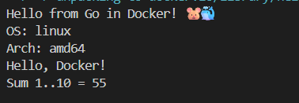

# hello-go

Учебный проект с CI/CD на GitHub Actions для Go-приложения с публикацией в GHCR.

## 📌 Цель работы

Научиться публиковать Docker-образ в **GHCR (GitHub Container Registry)** автоматически при push в `main`. Это превращает CI в **CI/CD**.

## 🎯 Что делает CI/CD

При каждом push в `main`:

- **Format check** — `gofmt -l .`
- **Lint** — `go vet ./...`
- **Tests** — `go test ./... -v`
- **Build** — `CGO_ENABLED=0 go build`
- **Publish** — `docker build` + `docker push` в **GHCR**: `ghcr.io/xem1zo/hello-go:latest`

## 📂 Структура проекта

```
hello-go/
├── .github/workflows/ci.yml
├── greeting/
│   ├── greeting.go
│   └── greeting_test.go
├── .gitignore
├── .dockerignore
├── Dockerfile
├── go.mod
├── main.go
└── README.md
```

## 🐹 Основной код

**`greeting/greeting.go`:**
```go
package greeting

import "fmt"

func Greet(name string) string {
	return fmt.Sprintf("Hello, %s!", name)
}

func SumRange(from, to int) int {
	sum := 0
	for i := from; i <= to; i++ {
		sum += i
	}
	return sum
}
```

**`main.go`:**
```go
package main

import (
	"fmt"
	"runtime"
	"hello-go/greeting"
)

func main() {
	fmt.Println("Hello from Go in Docker! 🐹🐳")
	fmt.Printf("OS: %s\n", runtime.GOOS)
	fmt.Printf("Arch: %s\n", runtime.GOARCH)
	fmt.Println(greeting.Greet("Docker"))
	fmt.Printf("Sum 1..10 = %d\n", greeting.SumRange(1, 10))
}
```

## 🚀 Запуск локально

```bash
docker build -t hello-go .
docker run --rm hello-go
```

Ожидаемый вывод:
```
Hello from Go in Docker! 🐹🐳
OS: linux
Arch: amd64
Hello, Docker!
Sum 1..10 = 55
```

### Скачать образ из GHCR

```bash
docker pull ghcr.io/xem1zo/hello-go:latest
docker run --rm ghcr.io/xem1zo/hello-go
```

## 📸 Результат запуска



## ✅ Результат

При push в `main`:
- Все проверки проходят ✅
- Docker-образ публикуется в **GHCR**: `ghcr.io/xem1zo/hello-go:latest`

**Actions:** https://github.com/xem1zo/hello-go/actions

**Пакет в GHCR:**  
https://github.com/users/xem1zo/packages/container/hello-go

## 📝 Вывод

Освоил:
- Настройку CI/CD для Go в GitHub Actions
- `gofmt`, `go vet`, `go test`, статическую сборку `CGO_ENABLED=0`
- Multi-stage Docker (golang:alpine → alpine)
- Публикацию в GHCR через `GITHUB_TOKEN`
- `docker/metadata-action` для автоматических тегов
- Разницу между CI и CI/CD